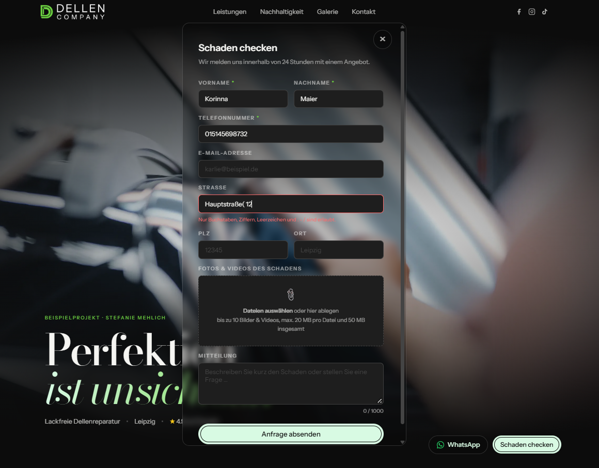

# Playwright Tests for an Example Website

🔗 [Live demo](https://stefaniemehlich.github.io/Example_Project/)

This is my first example project with Playwright: automated end-to-end tests for the draft of a website I built as part of another project. I used Claude Code as a pair-programming assistant while learning. Since this is only an example, there is no backend and no data is actually sent anywhere.

## At a glance

- 262 test cases in 12 test files, each run in Chromium, Firefox, and WebKit
- TypeScript with type checking
- Shared helper functions in `tests/helpers/`
- ESLint, including a rule that catches missing `await`
- [GitHub Actions](https://github.com/stefaniemehlich/Example_Project/actions): type checking, linting, and all tests on every push; each run uploads the full HTML test report as a downloadable artifact (kept for 30 days)
- Every test case has a recorded expected result; this automatically generates
  the overview in `dokuTestcases.md`

**Note:** Test titles, expected results, and `dokuTestcases.md` are in German because the example website was designed for a German business. Identifiers and comments in the code are in English.

## What's tested

| Area | Test file | Content |
|---|---|---|
| "Check damage" form | `damage-form.spec.ts` | Required fields, validation of all fields, upload, submit flow (success/error state), submitting with the keyboard, closing the overlay |
| Floating buttons | `cta-float.spec.ts` | Visibility, position while scrolling, opening the overlay |
| Gallery and reviews | `gallery.spec.ts`, `reviews.spec.ts` | Arrows, infinite loop, automatic rotation, position indicator |
| FAQ | `faq.spec.ts` | Expand/collapse, content |
| Navigation and footer | `navbar*.spec.ts`, `footer.spec.ts` | Internal and external links |
| Page in general | `homepage.spec.ts`, `images.spec.ts`, `seo.spec.ts` | Loads without errors, images, SEO basics |

## Main focus: the damage form

The 190 tests in `damage-form.spec.ts` best show how I design tests:

- **Table-driven test data:** each row is a test case with an input and
  expected message. A new case is a new row.
- **Boundary values:** e.g. 50 and 51 characters for the name field, 15 and 16
  digits for the phone number, 20 MB and 20 MB + 1 byte for the upload.
- **Positive and negative tests** are separated with tags and can be run
  individually. Each form field has its own tag as well.
- **Flows:** combinations of required fields, adding missing information
  afterwards, correcting invalid values, several errors at once, submitting
  with the keyboard, reopening the form before and after submission.

## Deliberately out of scope

- **Mobile view:** currently only checked where behavior differs from desktop
  (FAQ, buttons, images). Full mobile coverage is missing.
- **Accessibility:** no automated check yet. The next step would be
  `@axe-core/playwright` for the homepage and the form.
- **Backend:** the page has none. There are therefore no API tests, no login,
  and no test-data management.

## Running the tests

Prerequisite: Node.js

    npm ci
    npx playwright install
    npm test

| Command | Purpose |
|---|---|
| `npm test` | all tests in all three browsers |
| `npx playwright test --ui` | view and run tests individually |
| `npx playwright test --grep @negativtest` | only the negative tests |
| `npx playwright test --grep @validierung-plz` | all tests of one form field (here: postal code) |
| `npm run lint` | run ESLint |
| `npm run typecheck` | type checking |
| `npm run writeDokuTestcases` | regenerate `dokuTestcases.md` |

## License

The Playwright tests and tooling (`tests/`, `scripts/`, configuration files) are
MIT-licensed — see [LICENSE](LICENSE), feel free to reuse them. The example
website itself (`index.html`, `css/`, `images/`, its content and design) is
**not** covered by this license and may not be copied or reused.
